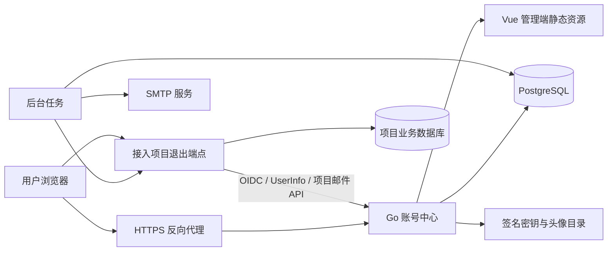

# 架构与认证边界

多鱼账号采用 Go 单体服务与 PostgreSQL。认证、管理 API、邮件、退出通知和监控按模块组织，任务可以按运行角色拆分；当前默认部署不依赖 Redis、对象存储或独立消息队列。

## 系统组成

默认 `combined` 进程同时提供 HTTP 与后台任务。`api` 只提供 HTTP，`worker` 不监听 HTTP；配置方法见 [配置参考](configuration.md)。数据库行锁协调队列领取，迁移使用事务与 advisory lock。首次签名初始化仍应由单实例完成，不能据此宣称已验收任意多节点部署。

## 模块与存储

| 模块 | 实现位置 | 保存或处理的内容 |
| --- | --- | --- |
| 账号与会话 | server/auth.go、server/main.go | 账号、密码摘要、邮箱验证、Cookie 会话 |
| OIDC 与续期 | server 下的协议实现与 refresh.go | 授权请求、授权码、访问令牌、刷新家族 |
| 通行密钥与扫码 | server 下 WebAuthn 与 qr.go | 凭据公钥、挑战、二维码状态和手机确认 |
| 管理权限 | admin.go、admin_pages.go、management_access.go | 项目、准入名单、管理角色、API 凭证 |
| 邮件 | service_mail.go、mail_queue.go、mail.go | 项目邮件元数据、短期加密正文和 SMTP 状态 |
| 退出通知 | logout_events.go | 签名退出事件、逐次尝试、失败补发 |
| 监控与清理 | monitoring.go、maintenance.go | 告警状态、审计事件、过期记录清理 |
| 界面 | admin/src、server/templates、admin/public/auth | 管理端、账号中心、登录与扫码页 |

PostgreSQL 保存中心业务状态；本地 data 保存 RSA 私钥、旧验签公钥和头像。邮件正文仅在队列处理中加密暂存，终态清除。项目自己的业务数据和本地登录会话不进入账号中心。

## 身份与项目模型

- 中心账号唯一标识为 `iss + sub`；邮箱可以修改，不应作为接入项目的稳定主键。
- 每个接入项目有独立 `client_id`、回调、客户端类型与准入策略。
- `app_users` 是账号与项目的登录关联，记录授权成功后的首次、最近时间和次数，不是授权依据。
- `grants` 在项目开启限制准入时决定哪些中心账号可以登录；中心可配置项目级身份角色，通过 profile 声明提供；各项目自行解释角色并实施具体业务权限。
- 同一账号可登录多个项目。当前不是“同一邮箱在不同项目下创建不同账号”的租户隔离模型。

## 标准登录流程

1. 项目生成并保存 state、nonce 和 PKCE verifier，携带 S256 challenge 跳转中心。
2. 中心校验客户端、精确回调与范围。用户登录或使用已有中心会话继续授权。
3. 中心返回一次性授权码。项目带原 verifier 兑换令牌；服务端客户端同时使用 HTTP Basic client secret。
4. 项目校验 state、签名、issuer、audience、有效期、nonce 等，再创建自己的本地会话。
5. 第二个项目可复用中心会话，但本地 Cookie 和业务权限仍独立。

`prompt=none` 在会话、准入及已授权范围满足时静默完成，否则返回协议错误；`prompt=login` 与 `max_age=0` 要求重新认证。需要续期的项目必须启用 refresh 能力并取得 `offline_access` 授权，不能只增加 scope 就获得无限期登录。

| 对象 | 当前寿命与性质 |
| --- | --- |
| 授权请求 | 10 分钟 |
| 中心会话 | 12 小时 |
| Access Token | 不透明令牌，5 分钟，受中心会话与授权状态约束 |
| ID Token | RS256 签名，5 分钟；用于身份声明，不代替项目会话撤销检查 |
| Refresh Token | 轮换、重放检测、范围约束；绝对寿命受中心会话限制 |

所有客户端强制 S256 PKCE。SPA 与原生客户端为公共客户端，不能可靠保存客户端密钥；服务端网站可以使用机密客户端。原生回调支持受限制的 loopback 和反向域名私有 scheme，具体规则以服务端校验为准。

## 三类授权不能混用

| 类型 | 目的 | 边界 |
| --- | --- | --- |
| OIDC 用户令牌 | 证明用户身份、读取获准资料 | 受用户会话、项目和 scope 限制 |
| 项目 API 凭证 | 项目后端读取配置或发送/查询邮件 | 绑定单项目；app:read、mail:send、mail:read；不是管理员令牌 |
| 中心管理角色 | 管理账号中心 | 由服务端检查，不由前端菜单决定 |

系统管理员管理全站；项目维护员只能查看和配置分配项目、准入、登录用户与客户端密钥；审计员只读安全日志、运行状态与退出事件。维护员不能管理全站账号、API 凭证或系统设置，角色分配入口不能授予系统管理员。

## 退出、撤销与停权

项目内退出只清除该项目本地会话。中心退出、会话撤销、账号停用及相关项目策略撤销会影响绑定的中心令牌，并对已配置项目产生后台退出通知。

接入方必须校验退出 token 的签名、issuer、audience、sid/sub、事件和时效，并按 jti 去重、清除对应会话。队列有限重试，失败可由系统管理员补发同一事件；网络或项目故障期间不承诺所有站点瞬时退出。

已签发 ID Token 在有效期内仍可能通过离线验签。敏感操作应在线复核 UserInfo/内省，或配合较短本地会话。刷新令牌重放会撤销所属家族，恢复账号或重新启用项目不会恢复已撤销的令牌。

## 安全措施与实际边界

- 密码使用 Argon2id；会话及服务凭证保存摘要；验证码使用 keyed HMAC、次数限制与单次消费。
- 生产 Cookie 为 Secure、HttpOnly、SameSite=Lax；管理写接口校验 Origin 与自定义头。
- WebAuthn 要求用户验证；扫码流程需要手机通行密钥验证、识别码核对和明确确认。
- 头像限制格式与像素，解码后重新编码；不接受 SVG 作为头像。
- 退出通知禁止跳转、限制地址并固定 DNS 解析结果，降低 SSRF 与 DNS rebinding 风险。
- 可信代理 CIDR 决定是否接受 X-Forwarded-For，不能信任任意外部转发头。
- 响应、审计与服务端事件使用请求编号关联；不把密码、验证码、token 或邮件正文写入事件日志。

管理列表支持服务端分页；无分页参数的兼容接口可能仍返回最近 200 条。通用搜索与 OFFSET 适合当前规模，深分页性能尚未完成量化验收。

已实现过期记录分批清理与旧验签公钥保留。旧头像、邮件幂等记录及部分失败记录仍需容量管理。项目尚未通过独立安全审计或完整 OIDC conformance 认证；真实设备和正式跨站行为见 [测试边界](testing.md)。

## 账号 ID、昵称与密码策略

- `users.account_id` 是注册时随机分配的 10 位数字字符串（首位非零），通过数据库唯一约束保证不重复。009 迁移为历史账号补齐账号 ID；分配器串行分配并重试随机碰撞。
- `users.id` 仍是内部关联键及 OIDC `sub`；不改动历史身份关系。接入项目继续用 `iss + sub`，不能用可修改昵称作为用户键。`GET /api/me` 与管理账号接口额外返回 `account_id`。
- 昵称使用已有 `name` 字段，允许 1–40 个字符，可在个人资料或管理员账号详情页编辑；修改昵称不改变账号 ID 或 `sub`。
- 新设、重置和修改密码接受 6–64 个 Unicode 字符，不要求字符种类，不去除密码空格。登录兼容已有旧密码；HTML 输入长度上限 128 个 UTF-16 单元供 64 个补充平面字符使用，提交时按 Unicode 码点检查新密码。
- 每个账号累计 5 次密码失败后锁定密码登录：10、60、360、2160 分钟，之后每轮乘 6。锁定期间请求不增加次数、不延长截止时间；到期清除当前轮计数但保留等级，下一轮 5 次再次升级。
- 成功密码登录或验证邮箱后重置/修改密码会清零失败次数及等级。密码锁定不影响验证码、通行密钥或已有会话；管理员停用账号仍会阻止各类登录。独立 IP/邮箱请求限流继续生效。
- 失败次数、等级和截止时间保存于 PostgreSQL，同一账号用行锁串行验证，重启不清零。HTTP 429 锁定响应提供 `Retry-After` 秒数；管理详情显示截止时间。极端递增达到 Go 时长表达上限（约 292 年）后饱和，避免溢出变成负数。

## 通行密钥设备说明

列表只返回设备类型、支持的连接方式、备份能力和创建环境摘要，不返回凭据公钥或原始认证数据。设备类型与连接方式来自保存的 WebAuthn 凭据；创建环境在注册成功时根据浏览器 User-Agent 提取系统和浏览器，不记录完整 User-Agent。创建环境不等同于密钥存储设备；连接方式列表也不表示某次登录实际使用了哪种方式。不能凭这些字段断言具体手机型号、Face ID、指纹或 PIN。

010 迁移新增 registration_device 字段。历史密钥仍可根据已有凭据显示类型和连接能力，未记录的创建环境显示“历史记录未保存”，不关联当前会话猜测历史设备。不影响已有密钥登录。

验证码验证后自动注册的新账号，默认密码使用密码学安全随机源生成，固定 32 位且至少包含一个大写字母、一个小写字母和一个数字，仅保存 Argon2id 哈希；不返回、不发送、不记录明文。再次验证码登录不覆盖密码，已有账号不批量重置。用户需要使用自己知道的密码时，通过邮箱验证后设置或重置。

## iPhone 扫码登录的添加与撤销

账号与安全提供独立的“iPhone 扫码登录 → 添加手机”页面。邮箱验证后创建的注册挑战由服务端记录扫码用途；只有完成该挑战的新通行密钥设置 `qr_enabled=true`。普通通行密钥默认不能批准扫码，旧记录也不自动开启，需要通过新入口添加。

手机验证成功的会话记录实际验证的 `passkey_id`；批准二维码和电脑领取登录会话时，都确认该密钥仍属于该账号且已添加扫码用途，并维持二维码创建后的新鲜验证要求。删除密钥后，待批准或待领取的扫码请求不能再使用该密钥完成登录。已完成登录的会话仍遵守原会话撤销规则。

桌面添加时提示系统优先选择手机，手机浏览器则直接创建密钥。浏览器提示是用户体验选项，不是可信设备类型证明，服务端不声称能强制识别 iPhone 型号或系统密码管理器。

## 单一超级管理员（当前规则）

系统仅允许一位超级管理员（`users.admin=true`），其他账号统一为普通用户。012 迁移清除历史委派角色和项目维护员关联，通过部分唯一索引阻止第二位超级管理员，通过 CHECK 约束禁止非 none 的 management_role。管理角色分配 API 返回 403，历史权限页面仅显示规则说明；此前审计员、项目维护员授权流程已停用。

初始化管理员仅在没有超级管理员时尝试创建，不会因变更启动邮箱而增加管理员。用户界面用黑底白字“超级管理员”角标展示身份。公开账号 ID 调整不改变内部 id / OIDC sub。

## 项目 Logo

apps.logo 保存已上传的同源 /project-logos/<随机名称>.png 路径。项目创建和编辑保存必须提供存在的本地 Logo，不接受外链或默认占位图冒充上传。超级管理员通过 POST /api/admin/project-logos 上传 logo 文件；文件保存在 DUOYU_DATA/project-logos，PNG/JPEG/WebP 不超过 2 MB、2000 万像素，重新编码为 PNG、最长边 512px，保持比例和透明度。列表与授权页使用同源图片；旧图床地址显示占位图，已有认证关系保持，下一次编辑保存必须补传。

替换 Logo 采用新随机地址，避免缓存旧图；未保存上传和旧版本文件暂保留，随 data 备份，不自动删除仍可能被引用的文件。多实例部署需共享持久化 data 目录。

## OIDC 协议边界与扩展（2026-10-28）

protocol.go 在现有 OIDC provider 前约束 Discovery 和允许的令牌 grant，统一 Bearer 错误。请求级数据库 tracer 只标记失败、不记录 SQL/令牌，在库将错误折叠成 invalid_grant 前捕获，返回 503。迁移 015 增加 extension 平台及独立 allowed_origins，现有项目一次性回填，新项目显式配置。来源检查覆盖 Token、UserInfo、撤销与预检；UserInfo 另外验证来源属于令牌所对应项目。详见 extension-integration.md。
